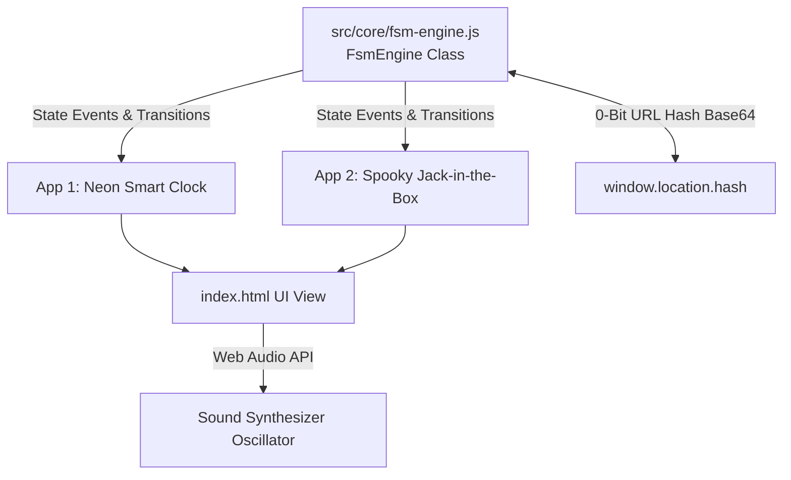

# Technical Design: Chrono-FSM Architecture

## 1. System Architecture



---

## 2. State Machine Schemas

### 2.1 Clock FSM Schema
```typescript
const clockSchema = {
  id: "neon-clock",
  name: "Neon Focus Clock",
  initialState: "IDLE",
  context: { remainingSeconds: 1500, cycleCount: 0 },
  states: {
    IDLE: {
      transitions: [{ event: "START", target: "FOCUSING" }]
    },
    FOCUSING: {
      transitions: [
        { event: "PAUSE", target: "PAUSED" },
        { event: "EXPIRE", target: "BREAK" },
        { event: "RESET", target: "IDLE" }
      ]
    },
    PAUSED: {
      transitions: [
        { event: "RESUME", target: "FOCUSING" },
        { event: "RESET", target: "IDLE" }
      ]
    },
    BREAK: {
      transitions: [
        { event: "START", target: "FOCUSING" },
        { event: "RESET", target: "IDLE" }
      ]
    }
  }
};
```

### 2.2 Spooky Jack-in-the-Box FSM Schema (50/50 Probabilistic)
```typescript
const boxSchema = {
  id: "spooky-box",
  name: "Halloween Jack-in-the-Box",
  initialState: "IDLE",
  context: { cranks: 0, outcome: null },
  states: {
    IDLE: {
      transitions: [{ event: "CRANK", target: "WINDING_1" }]
    },
    WINDING_1: {
      transitions: [
        { event: "CRANK", target: "WINDING_2" },
        { event: "RESET", target: "IDLE" }
      ],
      timeout: { durationMs: 15000, targetState: "IDLE" }
    },
    WINDING_2: {
      transitions: [
        { event: "CRANK", target: "READY_TO_POP" },
        { event: "RESET", target: "IDLE" }
      ],
      timeout: { durationMs: 15000, targetState: "IDLE" }
    },
    READY_TO_POP: {
      transitions: [
        {
          event: "POP",
          target: "POPPED_TREAT",
          probability: 0.50,
          action: (ctx) => { ctx.outcome = "TREAT"; }
        },
        {
          event: "POP",
          target: "POPPED_TRICK",
          probability: 0.50,
          action: (ctx) => { ctx.outcome = "TRICK"; }
        },
        { event: "RESET", target: "IDLE" }
      ]
    },
    POPPED_TREAT: {
      transitions: [{ event: "RESET", target: "IDLE" }]
    },
    POPPED_TRICK: {
      transitions: [{ event: "RESET", target: "IDLE" }]
    }
  }
};
```

---

## 3. UI/UX Interaction & Web Audio Design

1. **Neon Focus Clock**:
   - Cyan glowing 7-segment/monospace numbers (`#66fcf1`).
   - Clean Start / Pause / Reset button controls.
   - 440Hz triangle work tone, 880Hz chime for break.
2. **Jack-in-the-Box**:
   - Retro mechanical music box frame.
   - Crank rotation angle increases with tension:
     - `WINDING_1`: $\pm 10^\circ$, Sawtooth click (240Hz).
     - `WINDING_2`: $\pm 20^\circ$, Sawtooth click (360Hz).
     - `READY_TO_POP`: Pulsing glow, Warning beep (480Hz).
     - `POPPED_TREAT`: Major Triad Chime (C5, E5, G5).
     - `POPPED_TRICK`: Jumpscare low sawtooth screech (110Hz $\rightarrow$ 60Hz drop) + visual screen shake.
3. **0-Bit URL Hash Integration**:
   - Every state transition synchronizes with `window.location.hash`.
   - On page load, if a valid hash exists, state machine instantly restores.
