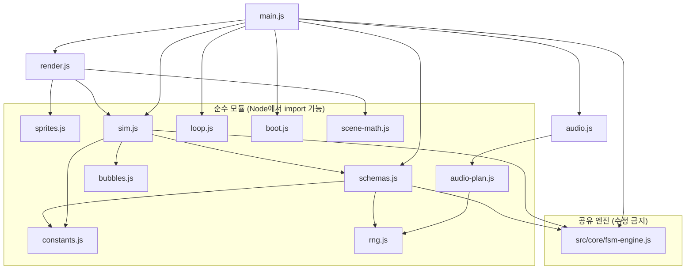
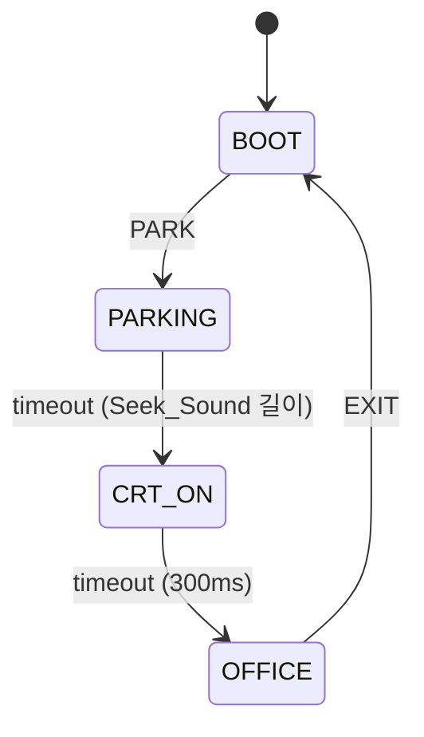
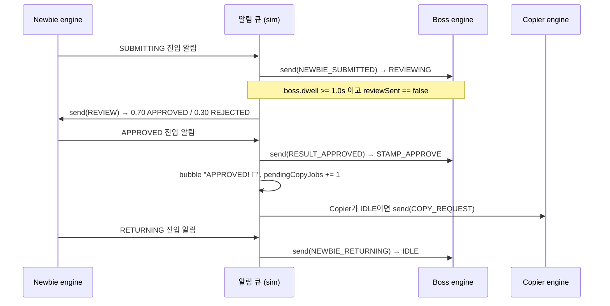
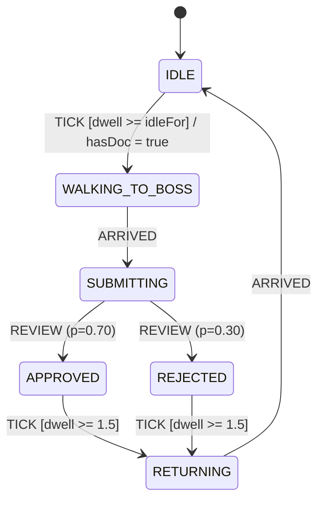
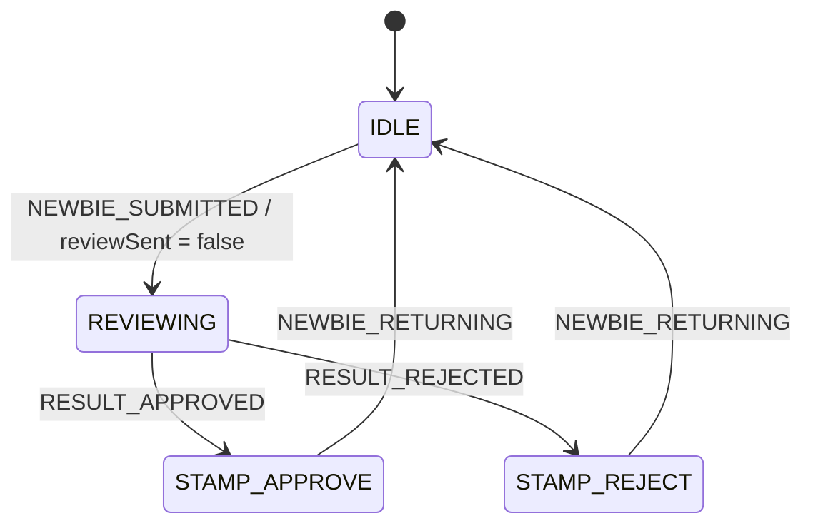
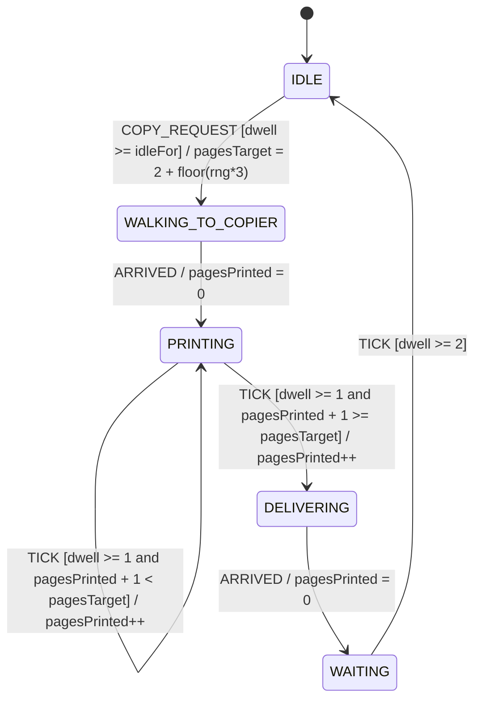
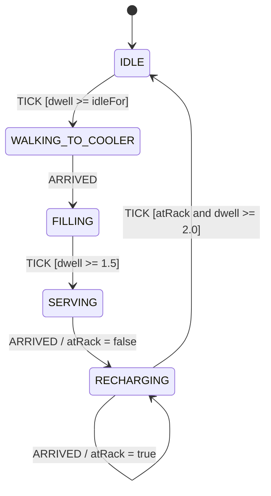

# Design Document

## Overview

PARK.EXE는 기존 Chrono-FSM의 공유 엔진(`src/core/fsm-engine.js`)을 한 줄도 바꾸지 않고 재사용하는 네 번째 앱이다. 진입점은 `park.html`이고, 모든 앱 코드는 `src/park/` 아래 ES 모듈로 둔다. 앱은 DOS 부팅 화면, 절차적 HDD 파킹 사운드, CRT 전환, 레트로 미니어처 픽셀 에이전트 스타일 사무실 스크린세이버로 이어진다.

설계의 핵심 결정은 다섯 가지다.

1. **순수 로직과 DOM 분리.** Agent_Schema, Sprite 데이터, 시뮬레이션, Boot 모델, Seek_Sound 계획, 화면 효과 수식은 `document`, `window`, Canvas API를 참조하지 않는 모듈에 둔다. Node에서 `import`만으로 로드되고, Verifier와 property test가 같은 코드를 그대로 검증한다 (Req 11.7, 12).
2. **시뮬레이션 시간 기반 타이머.** Agent의 대기 시간(1~3초 idle, 1.5초 결과 표시, 1000ms 인쇄 페이지 등)은 엔진의 `timeout`(벽시계 `setTimeout`)이 아니라 context의 `dwell`(상태 체류 시간)과 `TICK` 이벤트 guard로 표현한다. 탭이 숨겨지면 시뮬레이션이 멈추고(Req 10.2), 프레임 시간 상한(Req 10.5)과 결정적 테스트가 가능해진다. 앱 단계(`BOOT`, `PARKING`, `CRT_ON`, `OFFICE`)만 실제 시간으로 흐르므로 엔진의 `timeout`을 사용한다.
3. **알림 큐로 재진입 차단.** 엔진의 `send()`는 `action` 실행 후 `transitionTo()`를 호출하고, `enterState()`는 리스너를 동기 호출한다. 리스너나 `action` 안에서 다른 엔진(또는 같은 엔진)에 `send()`하면 상태가 덮어써지거나 알림이 중복된다. 그래서 리스너는 알림을 큐에 쌓기만 하고, 시뮬레이션이 외부 `send()` 호출이 모두 끝난 뒤 큐를 비우며 반응(말풍선, 이동 목표, 다른 Agent로 이벤트 전달)을 처리한다.
4. **엔진 무수정을 자동 증명.** Verifier가 `fsm-engine.js`의 LF 정규화 SHA-256을 기준 해시와 비교하고, `fsm-engine.ts`와 런타임 로직 동일성을 검사한다. Kiro hook이 엔진 파일 저장을 감시한다.
5. **외부 런타임 의존성 0 유지 (순수 바닐라 JS, Canvas 2D, Web Audio API).** 앱과 `npm test` 경로(Verifier)는 Node 내장 모듈만 쓴다. property-based test는 별도 스위트(`npm run test:prop`)로 분리하고, 그 스위트만 devDependency 1개(fast-check)를 쓴다. 이 결정은 아래 "설계 결정" 표에 근거와 함께 적었다.

### 조사 결과 요약 (코드베이스 기반)

| 조사 대상 | 발견 사항 | 설계에 미친 영향 |
|---|---|---|
| `src/core/fsm-engine.js` | `send()`는 guard를 통과한 후보가 2개 이상이거나 `probability`가 하나라도 있으면 `resolveProbabilisticTransition`으로 가중 선택한다. 후보가 여러 개인데 `probability`가 없으면 균등 무작위 선택한다. `Math.random()`을 직접 사용한다. | 같은 이벤트의 guard는 서로 배타적으로 작성한다. 확률 분기 Verifier는 `Math.random`을 시드 PRNG로 잠시 교체했다가 `finally`에서 복원한다. |
| 같은 파일 | `timeout`은 `setTimeout` 기반이고 `transitionTo`가 `clearTimer()`를 호출한다. self transition도 `onExit`와 `onEnter`를 다시 실행하고 `history`에 항목을 추가한다. | 앱 단계 엔진에만 `timeout` 사용. self transition 시 `onEnter`가 `pagesPrinted` 같은 누적값을 리셋하면 안 된다. |
| 같은 파일 | `destroy()`는 타이머를 지우고 리스너를 비운다. `schema.context`는 JSON 깊은 복사이므로 함수나 PRNG를 context에 넣을 수 없다. | `rng`는 스키마 팩토리 인자(클로저)로 주입한다. |
| 같은 파일 끝 | `module.exports` 호환 블록이 있고 `.ts`에는 없다. | 런타임 동일성 비교 시 이 CJS 호환 블록을 JS 쪽에서 제외한다. |
| `src/core/fsm-engine.ts` | 로직은 동일하고 타입 선언, `declare const`, 클래스 필드 선언만 다르다. | 정규화기는 타입 제거 후 필드 선언 줄을 제외한다. |
| `tests/verify_chrono.js` | CommonJS로 엔진을 `require`한다. 실패 시 `process.exit(1)`. 출력 접두사는 이모지 포함. | 이 파일은 수정하지 않는다. Verifier는 `PASS`/`FAIL`로 시작하는 줄(Req 12.1)을 낸다. 두 스크립트를 모두 실행하는 러너를 별도 파일로 둔다. |
| `index.html` | `<script type="module">`에서 `./src/core/fsm-engine.js`를 import. `unlockAudio`가 `pointerdown`, `keydown`, `touchstart`를 capture로 듣고 첫 제스처에서 AudioContext를 만든다. `visibilitychange`를 처리한다. | PARK.EXE의 `audio.js`도 같은 제스처 이벤트 집합을 쓰되, 컨텍스트 생성은 `unlock()` 안에서만 한다. |
| `.kiro/hooks/verify-chrono.kiro.hook` | JSON: `name`, `version`, `description`, `when.type`, `then.type = askAgent`, `then.prompt`. | 새 hook 4개도 같은 형식. 저장 감시는 `when.type = fileEdited`와 `patterns`를 사용한다. |
| `serve.js` | `/`는 `index.html`로 매핑. `.html .js .css .json`만 MIME 지정. 경로 이탈 차단. | `park.html`과 `.js`, `.json`은 추가 변경 없이 서빙된다. 서버는 수정하지 않는다. |
| `.github/workflows/pages.yml` | verify 잡은 `verify_chrono.js`만 실행. 배포 단계가 `index.html`과 `src/`만 `_site`로 복사한다. | `src/park/**`는 이미 포함된다. `park.html` 복사 한 줄과 verify 잡에 `verify_park.js` 실행을 추가한다. |
| 프로젝트 규칙 | package.json에 `type` 필드가 없다. 엔진 파일은 ESM 문법이고 `verify_chrono.js`는 `require`로 읽는다. | 이것은 Node의 ESM 문법 자동 감지(require(esm))에 의존한다. CI는 Node 24다. `src/park/package.json`에 `{"type":"module"}`을 두어 park 모듈만은 감지에 의존하지 않게 한다 (루트 package.json은 건드리지 않음). |

Node의 `stripTypeScriptTypes`(`node:module`)는 타입 어노테이션을 제거하는 내장 API다. 문서: [Node.js module.stripTypeScriptTypes](https://beta.docs.nodejs.org/module/stripTypeScriptTypes). 이 API가 처음 제공된 정확한 Node 버전은 이번 조사에서 확인하지 못했다. 구현 단계에서 로컬 Node와 CI(Node 24)에서 존재 여부를 확인하고, 없으면 해당 검사를 명확한 메시지와 함께 FAIL로 처리한다 (Req 12.14). Content was rephrased for compliance with licensing restrictions.

## Architecture

### 파일 구성

```text
park.html                      # 진입점. 모듈 로드 실패 시 텍스트 오류 표시 (Req 11.4)
src/park/
  package.json                 # {"type":"module"} : park 모듈의 ESM 해석을 고정
  constants.js        [pure]   # 논리 해상도, 속도, 시간 상수, 앵커 좌표, LED 주기
  rng.js              [pure]   # mulberry32 시드 PRNG
  sprites.js          [pure]   # 팔레트, 8개 Walk_Frame, decodeSprite, walkPose
  schemas.js          [pure]   # Boss/Newbie/Copier/Coffee/App 스키마 팩토리, tickAgent
  bubbles.js          [pure]   # Speech_Bubble 저장소, clampBubbleRect
  sim.js              [pure]   # 시뮬레이션: 엔진 5개 소유, 이동, 알림 큐, 반응, destroy
  loop.js             [pure]   # rAF 루프 래퍼 (raf/caf 주입, 일시정지, dt 상한)
  boot.js             [pure]   # Boot_Screen 모델 (입력 줄, 명령 판정, 힌트)
  audio-plan.js       [pure]   # planSeekSound(rng) : Seek_Sound 파라미터 계획
  scene-math.js       [pure]   # computeScale, shake/roll, crtOn, copierScanY, ledOn, bubbleAnim
  audio.js            [audio]  # Web Audio 합성/재생 (AudioContext 생성자 주입, DOM 참조 없음)
  render.js           [canvas] # Canvas 2D 렌더러 (Boot, Office, CRT 효과)
  main.js             [dom]    # DOM 연결: 입력, 제스처 unlock, visibility, 단계 엔진 연결
tests/
  verify_park.js               # 외부 의존성 없는 Verifier (CommonJS + 동적 import)
  run_all.js                   # verify_chrono.js와 verify_park.js를 모두 실행
  lib/report.js                # PASS/FAIL 줄 형식과 종료 코드 계산 (순수)
  props/*.test.js              # fast-check property test (node:test), npm run test:prop
.kiro/hooks/
  park-save-verify.kiro.hook
  park-engine-guard.kiro.hook
  park-run-all-tests.kiro.hook
  park-structure-audit.kiro.hook
```

`[pure]`로 표시한 모듈은 `document`, `window`, Canvas API를 참조하지 않는다 (Req 11.7). `audio.js`는 `window`를 참조하지 않고 `AudioContext` 생성자를 인자로 받는다. 그래서 Node에서 가짜 컨텍스트로 검증할 수 있다. Verifier에 정적 검사가 있어 `[pure]` 모듈과 `audio.js`에서 `document`, `window`, `canvas`, `getContext` 문자열을 찾으면 FAIL한다.

기존 파일 수정은 세 곳뿐이다 (Req 11.9). `index.html`에 `park.html` 링크 추가, `package.json` 스크립트 추가, `.github/workflows/pages.yml` 수정. 마지막 항목은 Req 11.8이 요구하는 배포 포함을 위한 것이며 Req 11.9의 보호 대상 파일 목록에 들어 있지 않다.

### 모듈 의존 관계



### 앱 단계 FSM (FsmEngine 인스턴스 1개)

화면 흐름도 같은 엔진으로 표현한다. 이 인스턴스는 Agent가 아니라 앱 단계 관리자이며, 실제 시간이 흐르는 `timeout`을 사용한다. 중복 시작(Req 1.9)과 전환 중 입력 무시(Req 3.8)는 "해당 상태에 그 이벤트의 transition이 없음 → `send()`가 `false`"로 자연히 해결된다.



| 상태 | 진입 시 (main.js 리스너) | 허용 이벤트 |
|---|---|---|
| BOOT | Boot 루프 시작, 입력 모델 초기화 | `PARK` |
| PARKING | Seek_Sound 재생, 흔들림/롤 시작 | 없음 (timeout만) |
| CRT_ON | CRT 켜짐 효과 시작 | 없음 (timeout만) |
| OFFICE | `createSimulation` 호출, Office 루프 시작 | `EXIT` |

PARKING의 `durationMs`는 `planSeekSound`가 반환한 `duration`을 밀리초로 바꾼 값이다. 오디오가 실패하거나 음소거여도 같은 `durationMs`로 진행하므로 타이밍이 동일하다 (Req 2.5, 2.7).

### Agent 협업 구조



한 프레임의 처리 순서는 다음과 같다 (`sim.update(dt)`).

1. `dt`를 받는다. 100ms 상한은 `loop.js`가 이미 적용했지만 `sim`도 방어적으로 한 번 더 `min(dt, 0.1)`을 적용한다.
2. 각 Agent: 목표가 있으면 `moveToward`로 이동. 목표에 처음 도달한 프레임에 `ARRIVED`를 큐에 넣는다.
3. 각 Agent: `tickAgent(engine, dt)` = `context.dwell += dt` 후 `send('TICK')`.
4. 협업 점검: Boss가 REVIEWING이고 `dwell >= 1.0`이며 `reviewSent`가 거짓이면 `reviewSent = true`로 하고 Newbie에 `REVIEW`를 큐에 넣는다. `pendingCopyJobs > 0`이고 Copier가 IDLE이며 `dwell >= idleFor`이면 `COPY_REQUEST`를 큐에 넣는다.
5. 큐 비우기: 큐 항목을 하나씩 꺼내 `send()`한다. 이 과정에서 생긴 알림은 `reactions`가 처리하며 새 항목을 큐에 넣을 수 있다. 무한 루프 방지를 위해 프레임당 최대 64회로 제한한다.
6. 말풍선 시간 경과, 시뮬레이션 시간 누적.

### 설계 결정

| 결정 | 선택 | 근거 / 대안 |
|---|---|---|
| Agent 대기 시간 | context `dwell` + `TICK` guard | 엔진 `timeout`은 벽시계라 숨은 탭에서도 흘러 Req 10.2/10.3과 충돌하고, 시드 기반 결정적 테스트가 어렵다. 대신 한 프레임 이하의 오차(최대 100ms 상한 이내)가 생긴다. |
| 교차 엔진 이벤트 | 알림 큐 | 엔진 수정 없이 `send` 재진입 문제를 피하는 유일한 방법. 대안(리스너에서 즉시 `send`)은 상태 덮어쓰기와 중복 알림 위험. |
| 반복 인쇄 | PRINTING self transition | Req 8.6이 요구. `onEnter`는 `dwell`만 리셋하고 `pagesPrinted`는 건드리지 않는다. 리스너는 `previous === current`인 알림을 "진입 효과"에서 제외한다 (말풍선, 이동 목표 재설정 금지). |
| 서버 랙 앞 도착 후 2초 | RECHARGING self transition `ARRIVED` | `ARRIVED` action이 `atRack = true`로 설정하고 `onEnter`가 `dwell`을 0으로 되돌리므로 도착 시점부터 2.0초가 센다. |
| 확률 분기 | 같은 이벤트의 transition 2개 + `probability` | 프로젝트 규칙. UI에서 `Math.random()` 금지. 대기 시간 무작위(idle 1~3초, pagesTarget 2~4)는 확률 분기가 아니므로 스키마 팩토리에 주입된 `rng`를 `onEnter`/`action`에서 호출한다. |
| 기준 해시 | `tests/verify_park.js` 상수, CRLF를 LF로 정규화 후 SHA-256 | Windows(autocrlf)와 Linux CI에서 같은 값이 나온다. 구현 시 `git show HEAD:src/core/fsm-engine.js`로 계산하고 작업 트리와 일치하는지 확인한다. |
| `npm test` | `node tests/run_all.js` | `a && b`는 a 실패 시 b를 건너뛴다. 러너는 두 스크립트를 모두 실행하고 하나라도 실패하면 종료 코드 1을 낸다 (Req 11.5). `verify_chrono.js`는 수정하지 않는다. |
| Property test 라이브러리 | fast-check (exact 버전 고정, devDependency), 실행기는 `node:test` | PBT를 직접 구현하지 않는다는 원칙과 "외부 런타임 의존성 0" 사이의 절충. 앱 런타임과 `npm test`/Verifier 경로는 외부 런타임 의존성이 없고, fast-check는 dev 전용이며 선택 스위트인 `npm run test:prop`만 `node_modules`가 필요하다. 사용자 확인이 필요한 항목이다 (아래 Error Handling 뒤 "열린 질문" 참조). |
| 스프라이트 형식 | 16줄 x 16자 문자열, 문자는 16진 팔레트 인덱스 | Req 12.5가 "팔레트 인덱스 정수 범위"를 검사하므로 문자→인덱스 변환이 명확해야 한다. 정의되지 않은 문자는 렌더러에서 투명 처리 (Req 4.9). |
| 모듈 로드 실패 표시 | `park.html`의 인라인 loader가 `import('./src/park/main.js')`를 호출하고 실패하면 모듈 목록을 리프부터 개별 `import()`로 시도해 실패 경로를 찾는다 | 정적 import 실패는 어느 모듈인지 브라우저가 항상 알려주지 않는다. 경로는 `console.error`, 안내는 `<pre>` 텍스트로 표시 (Req 11.4). 같은 출처 요청만 발생한다. |

## Components and Interfaces

### constants.js

```js
export const LOGICAL_W = 320, LOGICAL_H = 200;
export const WALK_FRAME_SEC = 0.160;
export const ARRIVE_EPS = 2;                 // px (Req 9.3, 9.5)
export const MAX_FRAME_SEC = 0.100;          // Req 10.5
export const BUBBLE_SEC = 2.0;
export const SPEED = { newbie: 40, copier: 48, coffee: 36, boss: 0 };   // px/s, 초기값이며 조정 가능
export const CRT_ON_MS = 300;                // 100..500 (Req 3.2)
export const SHAKE_MAX_PX = 4;               // Req 3.1
export const ROLL_PER_SEC = 1.25;            // >= 1 (Req 3.1)
export const COPIER_SCAN_PERIOD_SEC = 2.0;   // Req 5.2
export const LED_PERIODS_MS = [300, 700, 1300, 2000];  // 3개 이상, 300..2000 (Req 5.5)
export const OBJECTS = { /* bossDesk, copier, waterCooler, serverRack: {x,y,w,h} 고정 */ };
export const ANCHORS = { /* newbieStart, bossDeskFront, copierFront, coolerFront, rackFront */ };
```

좌표와 속도는 구현 단계에서 화면을 보며 조정하는 초기값이다. 불변 조건은 "Office_Object 좌표는 상수이며 프레임과 무관" (Req 5.1)이다.

### rng.js

```js
export function createRng(seed: number): () => number;   // mulberry32, [0,1)
export function withSeededMathRandom<T>(seed: number, fn: () => T): T; // finally에서 Math.random 복원
```

`withSeededMathRandom`은 Verifier와 property test에서 엔진의 `Math.random()` 확률 분기를 결정적으로 만들기 위한 도구다. 앱 코드는 사용하지 않는다.

### sprites.js

```js
export const SPRITES: Record<'boss'|'newbie'|'copier'|'coffee', {
  palette: string[],            // index 0 = 투명
  frames: [string[], string[]], // Walk_Frame A, B. 각 16줄 x 16자
  paperIndex?: number           // newbie만. 문서 픽셀의 팔레트 인덱스
}>;
export function decodeSprite(frame: string[], paletteLength: number): Int8Array; // 256칸, 정의 밖 문자는 -1
export function visiblePixels(decoded: Int8Array, opts: { paperIndex?: number, hasDoc: boolean }): Int8Array;
export function walkPose(walkTimeSec: number, moving: boolean): { frame: 0|1, dy: 0|-1 };
```

- `decodeSprite`는 줄이 16개가 아니거나 줄 길이가 16이 아니어도 예외를 던지지 않고 부족한 칸을 `-1`로 채운다. 그래야 렌더러가 데이터 결함에서 죽지 않는다 (Req 4.9). 크기와 인덱스 범위는 Verifier가 원본 데이터에 대해 엄격히 검사한다 (Req 12.4, 12.5).
- `walkPose`: `moving`이면 `frame = floor(t / 0.160) % 2`, `dy = frame === 0 ? 0 : -1`. 이동하지 않으면 `{frame: 0, dy: 0}` (Req 4.4, 4.5, 4.7). 좌우 반전은 렌더러가 Agent의 `dir < 0`으로 결정한다 (Req 4.6).
- `visiblePixels`: `hasDoc`이 거짓이면 `paperIndex` 픽셀을 투명(`-1`)으로 바꾼다 (Req 4.8).

### schemas.js

모든 팩토리는 `(deps: { rng: () => number })`를 받아 `FsmSchema`를 돌려준다. 스키마 `context`는 JSON 직렬화 가능한 값만 포함한다.

```js
export function createBossSchema(deps);
export function createNewbieSchema(deps);
export function createCopierSchema(deps);
export function createCoffeeSchema(deps);
export function createAppSchema({ seekMs, crtOnMs });
export function tickAgent(engine, dtSec): boolean;   // dwell += dt; engine.send('TICK')
export const AGENT_STATE_TARGETS: Record<AgentId, Record<StateId, AnchorName | null>>; // 상태별 이동 목표
```

상태 설정에는 엔진이 모르는 앱 전용 필드를 둘 수 있다. 엔진은 알 수 없는 필드를 무시한다.

- `say: string | string[]` (배열이면 sim.js가 주입된 rng로 하나 선택; 폰트 `Consolas, monospace`) : 진입 시 말풍선 대사 (Req 7.5, 7.6, 9.8)
- `walkTo: AnchorName` : 진입 시 이동 목표 (이 필드가 있는 상태에서만 Agent가 걷는다)

**공통 `onEnter`**: `ctx.dwell = 0`. 상태별 `onEnter`가 추가 초기화를 한다.

#### Junior_Developer (Newbie)



- 초기 context: `{ dwell: 0, idleFor: IDLE_MIN_SEC + rng() * IDLE_SPAN_SEC, hasDoc: false }` (팩토리에서 추출). IDLE `onEnter`가 같은 식으로 `idleFor`(4.0~8.0초, `IDLE_MIN_SEC = 4`, `IDLE_SPAN_SEC = 4`)를 다시 설정한다.
- `APPROVED`, `REJECTED` 진입 transition의 `action`이 `hasDoc = false`로 설정한다. 문서는 보스에게 제출된 것으로 본다.
- `SUBMITTING`에서만 `REVIEW` transition이 있으므로 다른 상태에서의 `REVIEW`는 `send()`가 `false`를 돌려주고 상태가 유지된다 (Req 7.15).
- `say`: APPROVED는 `APPROVED! 🎉`, REJECTED는 `REJECTED?! 😭`. 다른 Agent의 대사는 schemas.js `AGENT_STATE_SAY` 참조.
- `walkTo`: WALKING_TO_BOSS는 `bossDeskFront`, RETURNING은 `newbieStart`.

#### Boss



- 초기 context: `{ dwell: 0, reviewSent: false }`. Boss는 걷지 않는다 (`walkTo` 없음).
- 1.0초 후 `REVIEW` 전달은 스키마의 `action`이 아니라 `sim.js` 협업 점검(4단계)이 `boss.dwell`을 보고 수행한다. 다른 엔진으로 동기 `send`하는 `action`이 재진입 문제를 만들기 때문이다.
- `Nice brew ☕` 말풍선은 Boss 상태가 아니라 `sim.js`의 반응(Coffee_Bot이 SERVING에서 `ARRIVED`로 RECHARGING에 진입)이 Boss 말풍선으로 요청한다. Boss 상태 집합은 Req 7.11 그대로 유지된다.

#### Copier_Runner



- 초기 context: `{ dwell: 0, idleFor: 4~8 (rng), pagesPrinted: 0, pagesTarget: 3 }`. IDLE `onEnter`가 `idleFor`를 4.0~8.0초로 다시 뽑고, `dwell < idleFor`인 `COPY_REQUEST`는 guard가 거부한다 (sim은 `dwell >= idleFor`일 때만 작업을 소비하므로 작업이 유실되거나 중복 소비되지 않는다).
- 두 PRINTING transition의 guard는 서로 배타적이다. 그래서 엔진이 확률 선택 경로로 가지 않는다.
- `walkTo`: WALKING_TO_COPIER는 `copierFront`, DELIVERING은 `bossDeskFront`. PRINTING 중 copier의 스캔 광원은 렌더러가 `copier.state === 'PRINTING'`일 때 밝게 그린다 (Req 5.3, 5.4).
- self transition은 `dwell`을 0으로 되돌리므로 페이지 간격에는 프레임 하나 이하의 오차가 있다. 허용한다.

#### Coffee_Bot



- 초기 context: `{ dwell: 0, idleFor: 4~8 (rng), atRack: false }`. IDLE `onEnter`가 `idleFor`를 4.0~8.0초로 다시 뽑는다. RECHARGING의 `walkTo`는 `rackFront`이고, 서버 랙 앞에 도착하면 `ARRIVED`가 한 번 더 발생해 `atRack`이 참이 된다.
- FILLING 동안 렌더러가 water cooler 기포를 그린다. FILLING을 벗어나면 다음 프레임부터 그리지 않는다 (Req 5.6, 5.7).
- `say`: SERVING은 `커피 배달!` 같은 짧은 대사를 둘 수 있다. 필수는 아니다.

#### App 단계 스키마

```js
createAppSchema({ seekMs, crtOnMs }) = {
  id: 'park-app', initialState: 'BOOT',
  states: {
    BOOT:    { transitions: [{ event: 'PARK', target: 'PARKING' }] },
    PARKING: { timeout: { durationMs: seekMs,  targetState: 'CRT_ON' } },
    CRT_ON:  { timeout: { durationMs: crtOnMs, targetState: 'OFFICE' } },
    OFFICE:  { transitions: [{ event: 'EXIT', target: 'BOOT' }] }
  }
}
```

### sim.js

```js
export function createSimulation({ rng }): Simulation;

interface Simulation {
  time: number;
  agents: Record<'boss'|'newbie'|'copier'|'coffee', AgentRuntime>;
  bubbles: BubbleStore;
  pendingCopyJobs: number;
  update(dtSec: number): void;
  destroy(): void;              // 멱등. 엔진 destroy 정확히 1회씩 (Req 10.4, 10.7)
}
```

`destroy()`는 각 엔진에 대해 `try { engine.destroy() } catch (e) { errors.push(e) }`를 실행하고 모든 엔진을 처리한 뒤 반환한다. 이미 파괴된 상태에서 다시 호출하면 아무것도 하지 않는다. 파괴 후 `update()`도 아무것도 하지 않는다.

반응 규칙(`reactions`)은 알림 `{agentId, state, prev, event}`마다 다음을 수행한다.

| 조건 | 반응 |
|---|---|
| `prev === state` (self transition) | 말풍선/이동 목표 재설정 없음. 아래 협업 규칙만 해당되는 경우 처리 |
| 상태에 `say`가 있음 | `bubbles.show(agentId, say, time)` |
| 상태에 `walkTo`가 있음 | `agent.target = ANCHORS[walkTo]`, 없으면 `target = null` |
| newbie → SUBMITTING | boss에 `NEWBIE_SUBMITTED` 큐잉 |
| newbie → APPROVED | boss에 `RESULT_APPROVED` 큐잉, `pendingCopyJobs += 1` |
| newbie → REJECTED | boss에 `RESULT_REJECTED` 큐잉 |
| newbie → RETURNING | boss에 `NEWBIE_RETURNING` 큐잉 |
| coffee → RECHARGING (prev SERVING) | boss 말풍선 `Nice brew ☕` (2.0초) |

Copier에는 한 번에 `COPY_REQUEST` 하나만 전달되고, Copier가 바쁘면 `pendingCopyJobs`에 남아 IDLE이 될 때까지 기다린다. 승인 1회당 요청 1회가 정확히 한 번 소비된다 (Req 7.7).

### bubbles.js

```js
export function createBubbleStore(): {
  show(agentId, text, nowSec): void;        // 같은 agentId는 즉시 교체 (Req 9.10)
  update(nowSec): void;                     // 2.0초 경과분 제거 (Req 9.8)
  active(): Array<{ agentId, text, since }>;
};
export function clampBubbleRect(x, y, w, h): { x, y };   // 0..319, 0..199 안으로 보정 (Req 9.9)
```

렌더러는 매 프레임 Agent 머리 위 위치로 `clampBubbleRect`를 호출해 그린다.

### loop.js

```js
export function createLoop({ raf, caf, onFrame, now? }): {
  start(), stop(), pause(), resume()
};
```

- `onFrame(dtSec)`에 전달하는 `dt = min(rawMs, 100) / 1000`이다 (Req 10.5).
- `pause()`는 예약된 rAF를 취소하고 마지막 타임스탬프를 `null`로 바꾼다. `resume()` 후 첫 프레임의 `dt`는 0이다 (Req 10.2, 10.3).
- `stop()`은 rAF 예약을 해제하고 이후 `onFrame`이 호출되지 않게 한다. 단계 전환마다 루프 핸들을 새로 만든다. Office 루프는 BOOT 복귀 때 `stop()`된다 (Req 10.4).

### boot.js

```js
export function createBootModel(): BootModel;
export function isParkCommand(line: string): boolean;     // trim, 대소문자 무시, 'PARK' | 'PARK.EXE'
// BootModel
{
  lines: string[], input: string,
  typeChar(ch): void,        // 인쇄 가능 문자만, 최대 64자 (Req 1.2)
  backspace(): void,         // 비어 있으면 무동작 (Req 1.3)
  enter(): { action: 'PARK' | null },
  pointer(): { action: 'PARK' },   // 클릭/터치는 PARK + Enter와 동일 (Req 1.8)
  update(dtSec): void,       // 부팅 줄 순차 표시, 5초 무입력 힌트 (Req 1.1, 1.7)
}
```

- 부팅 타임라인: BIOS 메모리 체크 줄 0.0초, DOS 버전 줄 0.5초, Prompt 1.0초에 순서대로 별도 줄로 표시한다. 모두 2초 안에 끝난다.
- `enter()`: 입력이 PARK이면 `{action:'PARK'}`. 입력이 비어 있지 않고 PARK이 아니면 입력 줄 아래에 `Bad command or file name`을 추가하고 새 Prompt를 추가한다. 입력이 비어 있거나 공백뿐이면 오류 없이 새 Prompt만 추가한다.
- 힌트: Prompt 표시 뒤 무입력 시간이 5초에 이르면 `Type PARK to begin` 줄을 한 번 추가하고 `hintShown = true`. 입력(`typeChar`, `backspace`, `enter`, `pointer`)이 발생하면 무입력 시간을 0으로 되돌리고 새 Prompt가 갱신되기 전까지 `hintShown`을 유지해 반복 표시하지 않는다. 입력으로 Prompt가 갱신된 뒤에는 다시 1회 표시될 수 있다.

### audio-plan.js

```js
export function planSeekSound(rng): {
  duration: number,                                   // 2.0 <= d <= 3.0 (초)
  motor: { startHz: number, endHz: number, t0: number, t1: number },   // startHz > endHz
  seeks: Array<{ t: number, hz: number, gain: number }>,               // 6개 이상, t 간격 >= 0.020
  latch: { t: number, hz: number, gain: number }                       // 마지막 seek.t 이후
}
```

기본 계획: `duration 2.4`, `motor 180Hz → 40Hz`, 시크 클릭 8회(0.20, 0.45, 0.62, 0.95, 1.10, 1.38, 1.62, 1.85초), 래치 2.05초. `rng`는 클릭 시각에 ±0.03초 이내 지터와 음높이 변화만 주며 제약은 항상 만족한다. 모든 `t`는 `duration` 이하다.

### audio.js

```js
export function createAudio({ AudioContextCtor, setTimeout, clearTimeout }): {
  unlock(): void,                 // 사용자 제스처에서만 호출됨. 실패해도 예외 없음
  playSeek(plan): void,           // 잠금 해제 전/음소거/실패 시 조용히 무시
  sfx(name: 'stamp'|'blip'|'copy'): void,
  setMuted(on: boolean): void,    // 재생 중 음소거 시 100ms 이내 중지 (Req 2.8)
  isUnlocked(): boolean
};
```

- 합성은 `OscillatorNode`, noise `AudioBufferSourceNode`, `BiquadFilterNode`, `GainNode`만 사용한다. 오디오 파일 로드 없음 (Req 2.1).
- `AudioContextCtor`는 `unlock()` 안에서만 `new`한다. 모듈 로드 시점이나 `playSeek` 호출 시점에는 만들지 않는다 (Req 2.4).
- 모든 생성/재개/스케줄 호출은 `try/catch`로 감싼다. `resume()`가 반환하는 Promise의 거부도 삼킨다 (Req 2.5).
- 재생 종료 후 400ms 시점에 이 재생이 만든 노드를 모두 `disconnect()`한다 (요구 500ms 이내). 음소거 시에는 마스터 게인을 0으로 내리고 활성 소스를 `stop()`한 뒤 즉시 정리한다.
- 음소거 상태에서 `playSeek`와 `sfx`는 노드를 만들지 않는다 (Req 2.7).

### scene-math.js

```js
export function computeScale(vw, vh): number;                      // max(1, floor(min(vw/320, vh/200)))
export function shakeOffset(rng): { dx: number, dy: number };      // 각 |.| <= 4 정수
export function rollOffset(tSec, h = 200, rate = ROLL_PER_SEC): number;  // [0, h)
export function crtOnProgress(tMs, durationMs): number;            // [0,1], 단조 증가
export function copierScanY(tSec, top, bottom): number;            // 2초 주기, [top, bottom]
export function ledOn(tMs, periodMs): boolean;                     // 주기 반복 깜박임
export function moveToward(pos, target, speed, dtSec): { x, y, arrived: boolean };
```

`moveToward`는 `step = speed * dt`만큼 이동하되 남은 거리보다 크면 목표에 정확히 붙는다 (오버슈트 없음). 이동량은 프레임 수가 아니라 시간에만 비례한다 (Req 10.6).

### render.js (Canvas 2D)

- 논리 캔버스 320x200(오프스크린)에 Boot 또는 Office를 그리고, 화면 캔버스에는 `imageSmoothingEnabled = false`로 `computeScale` 정수 배율 확대 후 중앙 배치한다. `resize(w, h)`의 인자는 CSS px이 아니라 **디바이스 픽셀**이며, 캔버스 백킹 스토어는 디바이스 픽셀과 1:1이다. 베젤 화면 영역(`#park-screen`)이 320x200보다 작으면 1배율로 그리고 넘치는 부분은 잘린다 (Req 3.4, 3.5, 3.7).
- CRT 후처리는 확대된 화면 해상도에서 매 프레임 적용한다. 스캔라인은 배율 픽셀 단위 줄무늬, 비네트는 크기 변경 시 한 번 만든 방사형 그라디언트를 재사용, 인광 글로우는 `globalCompositeOperation = 'lighter'`로 밝은 영역을 약하게 한 번 더 그린다 (Req 3.3).
- PARKING 동안 논리 캔버스를 `shakeOffset`과 `rollOffset`으로 그린다. CRT_ON 동안 세로 스케일 `crtOnProgress`로 켜짐 효과를 그린다.
- Sprite는 `decodeSprite` 결과를 `fillRect` 1x1 단위로 그린다. 정수 좌표로 반올림하고, 반전은 열 순서를 뒤집어 그린다. 이미지 에셋 없음 (Req 4.3, 5.8).
- Office_Object 네 종류는 `OBJECTS` 상수 좌표에 도형과 픽셀로 그린다. 복사기 스캔 바는 `copierScanY(sim.time, ...)`, 서버 랙 LED는 `LED_PERIODS_MS`마다 `ledOn(sim.time * 1000, period)`, 정수기 기포는 FILLING 동안 `sim.time` 기반 위상으로 그린다. 애니메이션 시간은 모두 시뮬레이션 시간이라 탭 숨김 중 멈춘다.

### main.js

- 크기 계산(onResize): #park-screen.getBoundingClientRect() x devicePixelRatio로 디바이스 픽셀 크기를 구하고, computeScale로 최대 정수 배율 k를 정한 뒤 캔버스 백킹 스토어를 정확히 320k x 200k 디바이스 픽셀로 맞춘다. CSS 크기는 그 값 / dpr이며 디바이스 픽셀 경계에 맞춰 화면 영역 중앙에 둔다(레터박스는 베젤 안쪽의 검은 영역). 
esize 이벤트, ResizeObserver, matchMedia('(resolution: Ndppx)') 변경 시 다시 계산한다 (Req 3.4, 3.7).
- `park.html`의 loader가 로드한다. 단계 엔진 `new FsmEngine(createAppSchema(...))`을 만들고 `onStateChange`로 단계별 동작을 연결한다 (표는 Architecture 참고).
- 입력: `keydown`은 BOOT에서 Boot 모델로, OFFICE에서 `EXIT`로 보낸다. `pointerdown`은 BOOT에서 `boot.pointer()`, OFFICE에서 `EXIT`. PARKING/CRT_ON에서는 무시한다 (`send`가 `false`).
- 오디오 unlock: `pointerdown`, `keydown`, `touchstart`를 capture로 듣고 `audio.unlock()` 호출 (`index.html`의 `unlockAudio`와 같은 방식). 음소거 토글은 `M` 키.
- 가시성: `visibilitychange`에서 `hidden`이면 `loop.pause()`, `visible`이면 `loop.resume()`.
- 정리: OFFICE → BOOT 진입 시 `sim.destroy()`, Office 루프 `stop()`, Boot 루프 시작.

### park.html 베젤

- 이미지·외부 폰트 없이 HTML/CSS만으로 4:3(spect-ratio: 4 / 3, 폭 min(94vw, 88vh*4/3)) CRT 모니터를 중앙에 그린다: 베이지 플라스틱 본체(order-radius), 안쪽 움푹한 어두운 프레임, 유리 반사 오버레이(pointer-events: none), 하단 턱(브랜드 PARK-TRON 8088, 전원 LED), 스탠드. canvas#park-canvas는 검은 #park-screen 안에 있으며 image-rendering: pixelated. 폰트는 Consolas, monospace. 베젤을 클릭해도 window 수준 입력 리스너가 동작한다.

### park.html 로드 실패 처리

```html
<pre id="park-error" hidden></pre>
<canvas id="park-canvas"></canvas>
<script type="module">
  const MODULES = ['constants','rng','sprites','schemas','bubbles','sim','loop','boot',
                   'audio-plan','scene-math','audio','render','main'].map((n) => `./src/park/${n}.js`);
  import('./src/park/main.js').catch(async (err) => {
    const failed = [];
    for (const path of MODULES) {
      try { await import(path); } catch (e) { failed.push(path); console.error('[PARK] module load failed:', path, e); }
    }
    const box = document.getElementById('park-error');
    box.hidden = false;
    box.textContent = 'PARK.EXE: 모듈 로드 실패\n' + (failed.join('\n') || String(err));
  });
</script>
```

### Verifier 구조 (`tests/verify_park.js`)

CommonJS 파일이고 `node:fs`, `node:path`, `node:crypto`, `node:url`, `node:module`만 import한다 (Req 12.13). 모듈은 `import(pathToFileURL(...))`로 비동기 로드한다. 각 검사는 `check(name, fn)`으로 등록되고, 예외가 나면 그 검사만 FAIL로 기록하고 계속 진행한다 (Req 12.14).

```js
// tests/lib/report.js (순수)
export/ module.exports = { formatCheck(result), summarize(results) }
// formatCheck → 'PASS <name>' 또는 'FAIL <name> | expected: <e> | actual: <a>' (정확히 한 줄)
// summarize   → { total, pass, fail, exitCode: fail > 0 ? 1 : 0 }
```

마지막에 `SUMMARY total=N pass=P fail=F` 줄을 출력한다. 이 줄은 `PASS`나 `FAIL`로 시작하지 않으므로 검사 줄 수 계산에 섞이지 않는다. Hook은 이 줄로 요약을 보고한다.

검사 항목과 요구사항 매핑:

| 검사 이름 접두사 | 내용 | Req |
|---|---|---|
| `[engine:hash]` | `fsm-engine.js` LF 정규화 SHA-256 = 기준 해시. 불일치 시 두 해시를 출력 | 6.2, 6.5, 6.6 |
| `[engine:twin]` | `.js`와 `.ts`의 런타임 로직 동일 (주석, 공백, 타입, 클래스 필드 선언, JS의 CJS 호환 블록 제외) | 12.11 |
| `[audit:sprite]` | 8개 Walk_Frame이 16행 x 16열, 셀 인덱스가 `0 <= i < palette.length` | 4.2, 12.4, 12.5 |
| `[schema:*]` | 모든 target이 `states`에 존재, `initialState`가 `IDLE` (App 스키마 제외), 상태 집합이 요구사항과 일치 | 7.1, 7.11, 8.1, 9.1, 12.6, 12.7 |
| `[audit:probability]` | 같은 `(from, event)` 확률 그룹의 `probability` 합이 1.0 ± 1e-9 | 6.4, 12.8 |
| `[fsm:review]` | 시드 고정 `Math.random`으로 REVIEW 10,000회, APPROVED 비율 0.67~0.73, 같은 시드 재실행 시 동일 비율 | 7.4, 7.10, 12.9 |
| `[fsm:copier]` | `pagesTarget` 1, 3, 5에서 PRINTING 루프 정확히 `pagesTarget`회 뒤 DELIVERING | 8.3~8.6, 12.10 |
| `[audio:plan]` | `planSeekSound` 길이 2~3초, 클릭 6회 이상, 간격 20ms 이상, 래치 1회가 마지막 클릭 이후, 모터 하강 | 2.2, 2.3, 12.12 |
| `[audit:audio-gesture]` | 가짜 AudioContext로 `unlock()` 호출 전 생성자 호출 0회, 생성자 예외/`resume` 거부에도 예외 없음 | 2.4, 2.5 |
| `[static:pure]` | `[pure]` 모듈과 `audio.js`에 `document`/`window`/`getContext` 없음, Node에서 import 성공 | 11.7 |
| `[static:deps]` | `src/park` 전체에 `Math.random` 직접 호출 없음(`rng.js`의 시드 교체 도구 제외), 외부 URL, `fetch(`, 이미지 확장자 참조 없음 | 6.4, 11.2 |
| `[static:files]` | `park.html`, `src/park/*` 존재, `package.json` 스크립트 `test`, `test:park`, `index.html`의 `park.html` 링크, `pages.yml`의 `park.html` 복사 | 11.1, 11.5, 11.6, 11.8, 11.10 |
| `[hooks]` | 새 hook 4개가 유효 JSON이고 `name`, `when`, `then` 포함. `verify-chrono.kiro.hook`이 존재 | 13.1, 13.9 |

`[engine:hash]`의 기준 해시는 구현 시점에 `git show HEAD:src/core/fsm-engine.js`로 계산해 상수로 넣는다. 요구사항 6.5의 "park-exe 작업 이전 기준"은 이 값이다.

### package.json 변경

```json
"scripts": {
  "test": "node tests/run_all.js",
  "test:park": "node tests/verify_park.js",
  "test:prop": "node --test tests/props/",
  "start": "node serve.js"
},
"devDependencies": { "fast-check": "<exact version, installed with -E>" }
```

`test:prop`을 쓰지 않는 사람은 `npm install` 없이도 `npm test`를 그대로 쓸 수 있다.

### Pages 워크플로 변경

- verify 잡: `node tests/verify_chrono.js` 단계 뒤에 `node tests/verify_park.js` 단계 추가.
- deploy 잡 "Stage" 단계: `cp park.html _site/` 한 줄 추가. `cp -r src _site/src`가 `src/park/`를 이미 포함한다.

### Kiro Hooks

모두 `verify-chrono.kiro.hook`과 같은 JSON 형식이다. 기존 hook 파일은 바이트 단위로 건드리지 않는다 (Req 13.8).

| 파일 | `when` | `then.prompt` 요지 | Req |
|---|---|---|---|
| `park-save-verify.kiro.hook` | `fileEdited`, patterns `["src/park/**", "park.html"]` | `node tests/verify_park.js` 실행, `SUMMARY` 줄에서 total/PASS/FAIL 수 보고. 실패 시 실패한 검사 이름과 의심 파일 경로 보고. 엔진 수정은 엔진 자체 결함으로 확인될 때만 제안 | 13.2, 13.7 |
| `park-engine-guard.kiro.hook` | `fileEdited`, patterns `["src/core/fsm-engine.js", "src/core/fsm-engine.ts"]` | 변경 파일명과 함께 "공유 엔진 무수정 원칙 위반" 경고. `[engine:twin]`/`[engine:hash]` 결과(일치/불일치)와 `npm test` 결과(통과/실패)를 각각 보고 | 13.3, 13.4, 13.7 |
| `park-run-all-tests.kiro.hook` | `userTriggered` | `npm test` 1회 실행. Chrono-FSM 출력과 PARK.EXE 출력을 구분해 각각 PASS/FAIL 수 요약 | 13.5 |
| `park-structure-audit.kiro.hook` | `userTriggered` | `node tests/verify_park.js` 출력에서 `[audit:sprite]`, `[audit:probability]`, `[audit:audio-gesture]` 항목을 항목별 PASS/FAIL로 보고 | 13.6 |

## Data Models

### Sprite

```js
// 한 프레임: 길이 16인 문자열 배열, 각 문자열 길이 16. 문자 '0'..'9','a'..'f' = 팔레트 인덱스.
const BOSS_A = [
  '0000000000000000',
  /* ... 16행 ... */
];
// palette[0]은 항상 투명. 'newbie'는 paperIndex로 문서 픽셀을 표시.
SPRITES.newbie = { palette: ['transparent', '#101010', '#7dd3fc', '#f5f5f4', /* ... */], paperIndex: 3, frames: [A, B] };
```

`decodeSprite`는 문자를 `parseInt(ch, 16)`으로 해석하고, 숫자가 아니거나 `paletteLength` 이상이면 `-1`(투명)로 처리한다.

### AgentRuntime

```js
{
  id: 'boss' | 'newbie' | 'copier' | 'coffee',
  engine: FsmEngine,              // 상태의 유일한 보관소 (Req 6.1)
  pos: { x: number, y: number },  // 스프라이트 좌상단. 부동소수점, 렌더 시 반올림
  target: { x: number, y: number } | null,
  dir: 1 | -1,                    // 마지막 수평 이동 방향
  moving: boolean,                // target이 있고 아직 도착하지 않음
  walkTime: number                // 이동 중에만 누적, 정지 시 0
}
```

Agent의 FSM 상태는 `engine.getCurrentState()`로만 읽는다. `moving`과 `walkTime`은 상태가 아니라 표시용 파생 값이다.

### 스키마 context 초기값

| Agent | context |
|---|---|
| Newbie | `{ dwell: 0, idleFor: 2, hasDoc: false }` |
| Boss | `{ dwell: 0, reviewSent: false }` |
| Copier | `{ dwell: 0, idleFor: 4~8, pagesPrinted: 0, pagesTarget: 3 }` |
| Coffee | `{ dwell: 0, idleFor: 4~8, atRack: false }` |

### Bubble

```js
{ agentId: string, text: string, since: number }   // since = sim.time. since + 2.0 이후 제거
```

### SeekPlan

```js
{
  duration: 2.4,
  motor: { startHz: 180, endHz: 40, t0: 0, t1: 2.2 },
  seeks: [{ t: 0.20, hz: 1800, gain: 0.5 }, /* 모두 8개 */],
  latch: { t: 2.05, hz: 900, gain: 0.7 }
}
```

### BootModel

```js
{
  lines: string[],       // 표시된 줄 (BIOS, DOS 버전, Prompt 줄, 오류, 힌트)
  input: string,         // 최대 64자
  elapsed: number,       // 부팅 타임라인 경과 시간
  idleSec: number,       // 마지막 입력 후 경과 시간 (Prompt 표시 후부터)
  hintShown: boolean
}
```

### 기준 해시와 정규화

```text
normalizeLineEndings(src)  = src.replace(/\r\n?/g, '\n')
engineHash(src)            = sha256(normalizeLineEndings(src))
normalizeRuntime(js|ts)    = 주석 제거 → (ts이면 stripTypeScriptTypes) → 클래스 필드 선언 줄 제거
                             → JS의 module.exports 호환 블록 제거 → 모든 공백 제거
```

주석 제거는 문자열/템플릿 리터럴 안의 `//`를 건드리지 않는 작은 토크나이저로 구현한다.

## Correctness Properties

*A property is a characteristic or behavior that should hold true across all valid executions of a system-essentially, a formal statement about what the system should do. Properties serve as the bridge between human-readable specifications and machine-verifiable correctness guarantees.*

적용 범위: PBT는 순수 로직 계층(Boot 모델, 스키마와 시뮬레이션, 스프라이트 디코딩, 화면 수식, 오디오 계획과 가짜 컨텍스트 기반 오디오 게이팅, 루프, 리포터, 정규화기)에만 적용한다. Canvas 렌더링, CRT 시각 효과, hook 설정 파일, 워크플로 파일, 브라우저 로드 동작은 PBT 대상이 아니다.

### 속성 중복 검토

prework에서 testable로 분류된 항목을 다음과 같이 합쳤다.

- 1.2와 1.3은 같은 참조 모델(입력 줄)로 검증되므로 하나로 합친다.
- 1.4, 1.5, 1.6은 "Enter 결과 분류" 하나로 합친다.
- 1.9와 3.8은 모두 "단계 엔진이 허용되지 않은 이벤트를 무시한다"이므로 하나로 합친다.
- 2.2와 2.3(및 12.12)은 `planSeekSound` 구조 불변식 하나로 합친다.
- 2.4, 2.5, 2.7, 2.8은 하나의 이벤트 인터리빙 모델(unlock, play, mute, 생성 실패)로 검증하는 "오디오 게이팅" 하나와 "오디오 정리" 하나로 합친다.
- 3.4와 3.7은 `computeScale` 하나로 합친다.
- 4.4, 4.5, 4.7은 `walkPose` 하나로 합친다.
- 4.2, 4.9, 12.4, 12.5는 스프라이트 데이터 속성 하나(원본 데이터 엄격 검사)와 디코딩 견고성 하나로 나눈다.
- 6.4, 12.6, 12.7, 12.8은 스키마 정합성 하나로 합친다.
- 7.4, 7.10, 12.9는 REVIEW 분포 하나로 합친다.
- 7.12, 7.13, 7.14와 7.7은 시뮬레이션 협업 불변식 하나로 합친다.
- 8.4, 8.5, 8.6, 12.10은 인쇄 루프 하나로 합친다 (페이지 증가 시간은 별도 속성으로 두지 않고 같은 속성의 일부로 둔다).
- 9.2, 9.4, 9.7, 7.2, 7.8은 "dwell 임계값 이후에만 전이" 하나로 합친다 (대기 시간 범위 포함).
- 10.2, 10.3, 10.5는 루프 속성 하나로 합친다.
- 12.1, 12.2, 12.3, 6.6은 리포터 속성 하나로 합친다.

### Property 1: 입력 줄은 참조 모델과 같고 64자를 넘지 않는다

*For any* 인쇄 가능 문자 입력과 Backspace 입력이 섞인 임의의 시퀀스에서, Boot 모델의 입력 줄은 "문자 추가(64자에서 중단), 마지막 문자 삭제(빈 줄이면 무동작)"를 적용한 참조 모델과 항상 같고, 길이는 언제나 64 이하이다.

**Validates: Requirements 1.2, 1.3**

### Property 2: Enter 결과 분류

*For any* 문자열 `s`를 입력 줄에 넣고 Enter를 누르면, `trim(s)`가 대소문자 무시로 `PARK` 또는 `PARK.EXE`일 때만 `{action: 'PARK'}`를 돌려주고 줄이 늘어나지 않는다. `trim(s)`가 비어 있으면 새 Prompt 줄 1개만 추가된다. 그 외에는 `Bad command or file name` 줄 1개와 새 Prompt 줄 1개가 추가된다.

**Validates: Requirements 1.4, 1.5, 1.6**

### Property 3: 힌트는 5초 무입력 후 1회만 표시된다

*For any* 시간 증분과 입력 이벤트의 시퀀스에서, `Type PARK to begin` 줄은 Prompt가 표시된 뒤 무입력 시간이 5초에 이를 때만 추가되고, 입력으로 Prompt가 갱신되기 전에는 두 번 이상 추가되지 않는다.

**Validates: Requirements 1.7**

### Property 4: 단계 엔진은 허용되지 않은 이벤트를 무시한다

*For any* `PARK`, `EXIT` 및 임의 이벤트 시퀀스(mock timer로 시간 경과 포함)에서, 단계 엔진의 상태 이력은 `BOOT → PARKING → CRT_ON → OFFICE → BOOT` 순환에서 벗어나지 않으며, `PARKING` 또는 `CRT_ON` 중의 `PARK`/`EXIT`와 `PARKING`에 이미 들어간 뒤의 `PARK`는 `send()`가 `false`를 돌려주고 상태와 이력 길이를 바꾸지 않는다.

**Validates: Requirements 1.9, 3.8**

### Property 5: Seek_Sound 계획 불변식

*For any* 시드로 만든 `planSeekSound`에서, `duration`은 2.0 이상 3.0 이하이고, 모터 `startHz`가 `endHz`보다 크며, `seeks`는 6개 이상이고 인접 클릭 간격이 모두 0.020초 이상이며, `latch`는 정확히 1개이고 마지막 seek 시각보다 뒤이며, 모든 시각은 `duration` 이하이다.

**Validates: Requirements 2.2, 2.3, 12.12**

### Property 6: 오디오 게이팅과 실패 내성

*For any* `unlock`, `playSeek`, `sfx`, `setMuted(true/false)` 이벤트의 인터리빙과 임의의 `AudioContext` 생성 실패 또는 `resume` 거부 설정에서, 어떤 호출도 예외를 던지지 않고, `unlock` 전에는 생성자 호출이 0회이며, 음소거 상태에서는 새 노드가 만들어지지 않고, `setMuted(true)` 직후에는 활성 소스가 0개이다.

**Validates: Requirements 2.4, 2.5, 2.7, 2.8**

### Property 7: 재생이 끝나면 모든 노드가 정리된다

*For any* Seek_Sound 계획에 대해 가짜 스케줄러에서 재생 종료 후 400ms가 지나면, 그 재생이 만든 모든 오디오 노드에 `disconnect()`가 호출되어 있다.

**Validates: Requirements 2.6**

### Property 8: 화면 효과 수식의 범위

*For any* rng 값과 시간 `t`에서, `shakeOffset`의 `dx`, `dy`는 절댓값이 4 이하의 정수이고, `rollOffset(t)`은 `[0, 200)`에 있으며 `rollOffset(t + 1 / ROLL_PER_SEC) = rollOffset(t)`이어서 초당 1회 이상 순환하고, `crtOnProgress`는 `[0, 1]`에서 시간에 대해 단조 증가하며 `CRT_ON_MS`는 100 이상 500 이하이다.

**Validates: Requirements 3.1, 3.2**

### Property 9: 정수 배율 최대화

*For any* 뷰포트 `(vw, vh)`(0 포함)에서, `computeScale`은 1 이상의 정수이고, `vw >= 320`이고 `vh >= 200`이면 `320 * scale <= vw`, `200 * scale <= vh`이며 `scale + 1`은 둘 중 하나를 넘는다. 뷰포트가 320x200보다 작으면 `scale = 1`이다.

**Validates: Requirements 3.4, 3.7**

### Property 10: 원본 스프라이트 데이터 무결성

*For any* Agent 종류와 Walk_Frame(총 8개)에서, 프레임은 정확히 16행이고 각 행은 정확히 16열이며, 디코딩한 256개 셀은 모두 `0 <= index < palette.length`인 정수이다.

**Validates: Requirements 4.2, 12.4, 12.5**

### Property 11: 스프라이트 디코딩은 정의 밖 문자를 투명 처리하고 실패하지 않는다

*For any* 임의의 문자열 배열(행 수와 길이, 문자 구성이 임의)에 대해 `decodeSprite`는 예외 없이 256칸을 돌려주고, 팔레트 정의 밖의 문자는 `-1`(투명)로 디코딩되며, 정의 안의 문자는 같은 위치에서 원래 인덱스로 디코딩된다.

**Validates: Requirements 4.9**

### Property 12: 걷기 포즈는 시간에서 결정된다

*For any* 걷기 누적 시간 `t >= 0`에서, 이동 중이면 `frame = floor(t / 0.160) mod 2`이고 `dy`는 `frame = 0`일 때 0, `frame = 1`일 때 -1이며, 이동 중이 아니면 `{frame: 0, dy: 0}`이다.

**Validates: Requirements 4.4, 4.5, 4.7**

### Property 13: 문서 픽셀은 문서를 들고 있을 때만 보인다

*For any* Junior_Developer 프레임과 `hasDoc` 값에서, `visiblePixels`는 `hasDoc`이 참이면 디코딩 결과와 같고, 거짓이면 `paperIndex` 픽셀만 투명으로 바뀌고 나머지 픽셀은 변하지 않는다.

**Validates: Requirements 4.8**

### Property 14: 오브젝트 애니메이션은 주기적이고 범위 안에 있다

*For any* 시간 `t`에서, `copierScanY(t, top, bottom)`는 `[top, bottom]`에 있고 `copierScanY(t + 2) = copierScanY(t)`이며, 각 LED의 `ledOn(t, period)`는 `period`마다 반복되고, `LED_PERIODS_MS`는 서로 다른 값이 3개 이상이며 모두 300 이상 2000 이하이다.

**Validates: Requirements 5.2, 5.5**

### Property 15: 스키마 정합성

*For any* 시드로 만든 Boss, Newbie, Copier, Coffee 스키마에서, 모든 transition의 `target`은 해당 스키마의 `states`에 있고, `initialState`는 `IDLE`이며, 같은 출발 상태와 같은 이벤트를 공유하면서 `probability`를 가진 transition 그룹은 `probability` 합이 1.0 ± 1e-9이다.

**Validates: Requirements 6.4, 12.6, 12.7, 12.8**

### Property 16: 엔진 정규화 비교의 불변성과 민감성

*For any* 엔진 소스 변형에 대해, 주석, 공백, 줄바꿈(CRLF/LF)만 바꾼 변형은 `engineHash`와 `normalizeRuntime` 결과가 원본과 같고, 런타임 코드 문자 하나를 바꾼 변형은 `engineHash`가 달라진다.

**Validates: Requirements 6.5, 12.11**

### Property 17: REVIEW 분포와 재현성

*For any* 시드에서, 시드 고정 `Math.random`으로 SUBMITTING 상태의 Junior_Developer 엔진에 `REVIEW`를 10,000회 보내면 APPROVED 비율은 0.67 이상 0.73 이하이고, 같은 시드로 다시 실행하면 같은 비율이 나온다.

**Validates: Requirements 7.4, 7.10, 12.9**

### Property 18: REVIEW는 SUBMITTING에서만 효과가 있다

*For any* Junior_Developer 엔진과 임의의 이벤트 시퀀스에서, 현재 상태가 SUBMITTING이 아닐 때 `REVIEW`는 `false`를 돌려주고 상태와 context를 바꾸지 않으며, 모든 시점에서 현재 상태는 `states`에 있는 값이다.

**Validates: Requirements 7.15, 7.1**

### Property 19: 시간 임계값은 프레임 분할과 무관하게 지켜진다

*For any* 시드와 *any* 프레임 시간 분할(합이 같은 임의의 `dt` 목록, 각 100ms 이하)에서, Newbie의 IDLE→WALKING_TO_BOSS 전이는 `dwell`이 `idleFor`(4.0 이상 8.0 이하)에 이른 첫 프레임에서 일어나고, APPROVED/REJECTED→RETURNING은 `dwell >= 1.5`에서, Coffee_Bot의 IDLE→WALKING_TO_COOLER는 `dwell >= idleFor`(4.0~8.0), Copier_Runner의 IDLE에서 `COPY_REQUEST` 수락은 `dwell >= idleFor`, FILLING→SERVING은 `dwell >= 1.5`, RECHARGING→IDLE은 도착 후 `dwell >= 2.0`에서, Copier_Runner의 WAITING→IDLE은 `dwell >= 2.0`에서만, 그리고 그 첫 프레임에서 일어난다. 전이는 임계값 이전에는 일어나지 않는다.

**Validates: Requirements 7.2, 7.8, 8.8, 9.2, 9.4, 9.7**

### Property 20: 시뮬레이션 협업 불변식

*For any* 시드와 프레임 분할로 시뮬레이션을 진행하고 각 프레임이 끝난 시점에서, Boss 상태는 Newbie 상태로부터 결정된다 (SUBMITTING이면 REVIEWING, APPROVED이면 STAMP_APPROVE, REJECTED이면 STAMP_REJECT, 그 외에는 IDLE). 누적된 APPROVED 진입 횟수는 Copier_Runner가 받았거나 `pendingCopyJobs`에 남은 복사 요청 수와 같다.

**Validates: Requirements 7.7, 7.12, 7.13, 7.14**

### Property 21: 인쇄 루프는 정확히 pagesTarget번 수행된다

*For any* `pagesTarget >= 1`에서, PRINTING에 들어간 Copier_Runner에 1000ms 간격으로 `TICK`을 보내면 `pagesPrinted`는 매번 1씩 증가하고, `pagesTarget - 1`번째까지는 PRINTING을 유지하며(self transition), 정확히 `pagesTarget`번째에 DELIVERING으로 전이한다. WALKING_TO_COPIER로 전이할 때 설정되는 `pagesTarget`은 rng 값에 상관없이 2 이상 4 이하의 정수이다.

**Validates: Requirements 8.4, 8.5, 8.6, 8.9, 12.10**

### Property 22: 이동은 오버슈트 없이 도착하고 주사율과 무관하다

*For any* 시작점, 목표점, 속도와 같은 총 시간 `T`를 30Hz, 60Hz, 144Hz로 분할한 프레임들에서, `moveToward`는 목표를 지나치지 않고, 남은 거리가 이동량 이하이면 목표 좌표에 정확히 도착해 `arrived`가 참이 되며, 세 주사율의 이동 거리 차이는 1px 이하이다.

**Validates: Requirements 10.6, 9.3**

### Property 23: 말풍선 수명, 교체, 화면 경계

*For any* Agent와 `show`/`update` 시각의 시퀀스에서, 한 Agent에 대해 활성 말풍선은 최대 1개이고, 마지막 `show` 후 2.0초가 지나면 제거되며, 새 `show`는 기존 말풍선을 즉시 대체한다. *For any* 앵커와 말풍선 크기(320x200에 들어가는 크기)에서 `clampBubbleRect`가 돌려준 사각형은 `x` 0~319, `y` 0~199 안에 완전히 들어온다.

**Validates: Requirements 9.8, 9.9, 9.10**

### Property 24: 루프는 dt를 제한하고 일시정지와 재개를 처리한다

*For any* 가짜 rAF 타임스탬프 시퀀스(큰 간격 포함)와 `pause`/`resume`/`stop` 호출 순서에서, `onFrame`에 전달되는 `dt`는 0.100초 이하이고, `pause` 이후 `resume` 전에는 `onFrame`이 호출되지 않으며, `resume` 후 첫 프레임의 `dt`는 0이고, `stop` 이후에는 예약된 rAF가 남지 않는다.

**Validates: Requirements 10.2, 10.3, 10.4, 10.5**

### Property 25: destroy는 모든 엔진을 정확히 1회 정리한다

*For any* 시뮬레이션 상태와 일부 엔진의 `destroy()`가 예외를 던지는 임의의 부분집합에서, `sim.destroy()`는 예외를 밖으로 던지지 않고, 모든 엔진의 `destroy()`를 정확히 1회씩 호출하며, 다시 호출해도 추가 호출이 없다.

**Validates: Requirements 10.4, 10.7**

### Property 26: 리포터 출력 형식과 종료 코드

*For any* 검사 결과 목록(통과와 실패가 섞임, 검사 함수가 예외를 던지는 경우 포함)에서, 보고서는 검사마다 정확히 한 줄이고 그 줄은 `PASS` 또는 `FAIL`로 시작하며, FAIL 줄은 검사 이름과 기대값, 실제값을 포함하고, 모든 검사가 실행되며, 종료 코드는 실패가 1개 이상이면 1이고 아니면 0이다.

**Validates: Requirements 12.1, 12.2, 12.3, 12.14, 6.6**

## Error Handling

| 상황 | 처리 | Req |
|---|---|---|
| `AudioContext` 없음/생성 예외/`resume` 거부 | `audio.js`가 모든 호출을 `try/catch`로 감싸고 조용히 무음 진행. 단계 엔진의 `timeout`은 오디오와 무관 | 2.5 |
| 오디오 제스처 전 재생 요청 | 무시 (`isUnlocked() === false`) | 2.4 |
| 음소거 중 재생 중지 | 마스터 게인 0, 활성 소스 `stop()`, 노드 즉시 정리 | 2.7, 2.8 |
| 스프라이트에 정의되지 않은 팔레트 문자 | `decodeSprite`가 `-1`로 처리하고 렌더러가 건너뜀. Verifier는 원본 데이터에서 이를 FAIL로 잡는다 | 4.9, 12.5 |
| 뷰포트가 320x200보다 작음 | 배율 1, 넘치는 부분 잘림, 예외 없음 | 3.7 |
| 허용되지 않은 시점의 입력 | 엔진이 `send() === false`를 반환하고 상태 유지 | 1.9, 3.8, 7.15 |
| Guard를 만족하는 후보가 없는 `TICK` | `send()`가 `false`. 정상 동작이며 오류가 아님 | 7, 8, 9 |
| 프레임 간격이 매우 큼 | `loop.js`와 `sim.update`가 `dt`를 0.1초로 제한 | 10.5 |
| 탭 숨김 | `loop.pause()`, 복귀 시 첫 `dt` = 0 | 10.2, 10.3 |
| `destroy()` 중 예외 | 엔진별 `try/catch`, 나머지 정리 계속, Boot 복귀 완료 | 10.7 |
| 알림 큐 폭주 | 프레임당 64회 처리 한도. 남은 항목은 다음 프레임으로 넘긴다 | - |
| ES 모듈 로드 실패 | `park.html` loader가 실패 모듈 경로를 `console.error`로 출력하고 `<pre>`에 텍스트 오류 표시 | 11.4 |
| Verifier에서 파일 읽기/import 실패 | 해당 검사를 FAIL로 출력, 나머지 계속, 종료 코드 1 | 12.14 |
| `stripTypeScriptTypes` 없음 (오래된 Node) | `[engine:twin]`을 FAIL로 출력하고 필요한 Node 버전을 메시지에 포함 | 12.14 |
| 엔진 해시 불일치 | `FAIL [engine:hash]`에 기대/실제 해시 출력, 종료 코드 1 | 6.6 |
| 엔진 자체 결함이 의심될 때 | hook은 결함이 엔진 안에서 확인된 경우에만 수정 제안. 기본은 앱 코드를 고친다 | 13.7 |

### 열린 질문

- property test용 devDependency(fast-check) 허용 여부. 허용하지 않으면 `tests/props/`를 만들지 않고, 같은 속성을 Verifier 안에서 시드 고정 난수(`rng.js`)로 100회 이상 반복하는 방식으로 바꾼다. 이 경우 shrinking 같은 PBT 라이브러리 기능은 없다.

## Testing Strategy

### 이중 접근

- **Verifier (`npm run test:park`, `npm test`에 포함)**: 외부 의존성 없이 Node 내장 모듈만 쓰는 스크립트. 파일 구조, 정적 검사, 엔진 해시/트윈, 스프라이트 크기, 스키마 정합성, 시드 고정 확률 분포, Copier 루프, Seek 계획, 가짜 AudioContext 게이팅. `PASS`/`FAIL` 한 줄 출력.
- **Property test (`npm run test:prop`)**: 위 26개 속성을 fast-check로 구현하고 `node:test`로 실행한다. 속성 하나당 property-based test 하나. 각 test는 최소 100회 반복(`numRuns: 100` 이상)으로 설정한다. 확률 분포(Property 17)는 반복당 10,000회 시도를 하므로 `numRuns`를 낮춰 20회 이상으로 하되 이 예외를 주석에 명시한다.
- **Unit/example test**: 구조적 검사(상태 집합, 초기 상태, 말풍선 대사 텍스트, 부팅 타임라인, 정적 스캔, hook JSON, 스크립트 정의)는 예시 기반으로 Verifier에 둔다.
- **수동 브라우저 점검**: `npm start` 후 `/park.html`에서 CRT 효과, 정수 배율 선명도, 흔들림/롤/켜짐 전환, 사운드 청감, 탭 숨김/복귀, 모듈 로드 실패 메시지 (파일 이름을 잠시 바꿔 확인).

### Property test 규칙

- 라이브러리: fast-check (exact 버전 고정). PBT를 직접 구현하지 않는다.
- 각 속성은 하나의 property-based test로 구현한다.
- 각 test 위에 주석 태그를 단다. 형식: `Feature: park-exe, Property {번호}: {속성 제목}`.
- 시간에 의존하는 속성(Property 4, 7)은 `node:test`의 `mock.timers`, 가짜 rAF, 가짜 스케줄러를 사용해 벽시계를 쓰지 않는다.
- 엔진의 `Math.random()`이 관여하는 속성(Property 17, 18, 20)은 `withSeededMathRandom`으로 감싸고 `finally`에서 복원한다.
- 시뮬레이션 속성(Property 19, 20, 22)의 프레임 분할 생성기는 각 `dt`를 0 초과 0.1 이하로, 합을 목표 시간으로 맞춘다.

### PBT를 쓰지 않는 영역과 대체 검증

| 영역 | 이유 | 검증 방법 |
|---|---|---|
| Canvas 렌더링, CRT 후처리, 오브젝트 그리기 (Req 3.3, 3.5, 5.6, 5.7, 10.1) | UI 렌더링은 입력 변화에 따른 보편 속성을 쓰기 어렵다 | 수동 브라우저 점검, 순수 수식(Property 8, 9, 14)으로 로직 부분만 검증 |
| `park.html` 모듈 로드 실패 표시, 서빙 시간 (Req 11.3, 11.4) | 브라우저 동작, I/O | 수동 점검 |
| Hook 파일, Pages 워크플로 (Req 11.8, 13) | 선언적 설정 | JSON 스키마 형태 검사와 필수 문자열 포함 검사 (Verifier `[hooks]`, `[static:files]`) |
| 엔진 무수정, 기존 파일 무변경 (Req 6.2, 6.7, 6.8, 11.9) | 일회성 무결성 확인 | 해시 비교, `verify_chrono.js` 결과, 코드 리뷰 |

### 검증 실행 순서 (구현 완료 기준)

1. `node tests/verify_park.js` : 모든 줄이 `PASS`, 종료 코드 0.
2. `npm test` : Chrono-FSM 검사와 PARK.EXE 검사가 모두 통과.
3. `npm run test:prop` : 26개 속성 통과 (fast-check 허용 시).
4. 수동: `npm start` → `http://127.0.0.1:8089/park.html`.
