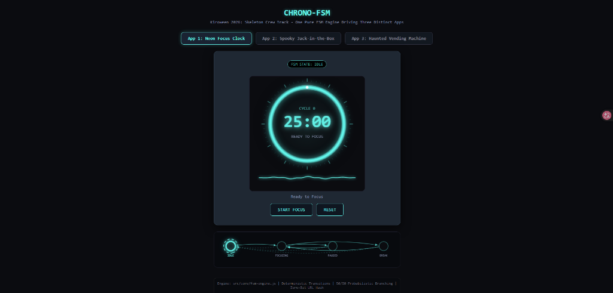
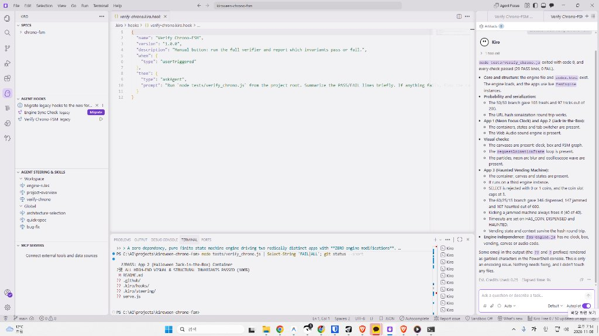
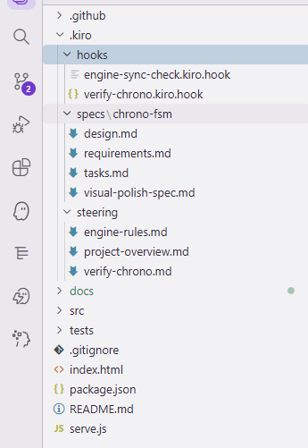

# Chrono-FSM: One Core, Three Apps

> **Kiroween 2026 · Skeleton Crew Track**
> A zero-dependency, pure finite state machine engine driving three radically distinct apps with **ZERO engine modifications**.

| App 1: Neon Focus Clock | App 2: Halloween Jack-in-the-Box | App 3: Haunted Vending Machine |
| --- | --- | --- |
| Pomodoro-style deep work timer on a neon arc gauge | Crank-and-pop mechanical music box with a 50/50 Treat or Trick | Coin-operated machine with a credit guard and a 60/25/15 Dispense, Jam or Haunt |
| `IDLE → FOCUSING ⇄ PAUSED`, then `BREAK` | `IDLE → WINDING_1 → WINDING_2 → READY_TO_POP → POPPED_TREAT / POPPED_TRICK` | `IDLE → HAS_COIN → DISPENSED / JAMMED / HAUNTED` |

All three apps import the same file, `src/core/fsm-engine.js`, and differ only in the **schema** (a plain object) they hand to it. The vending machine was added last as the stress test: a third app with new needs (guards, a self transition, three weighted outcomes) and **no change to the engine**. `git diff` on `src/core/` since the first commit is empty. Everything you see on screen, including the node graph, is driven by that one engine.

---

## Live Screenshots & Kiro Proof

| App 1: Neon Focus Clock Running | Kiro IDE & Automated Hook Verification | Kiro Spec/Hook File Structure |
| :---: | :---: | :---: |
|  |  |  |


---

## The Skeleton Idea

The track asks for a clean, flexible skeleton that proves its versatility by powering distinct applications. This project makes that literal.

```
                 +--------------------------------+
                 |   src/core/fsm-engine.js       |   ~150 lines, no dependencies
                 |   states, transitions, guards, |
                 |   probability, timeouts,       |
                 |   hash snapshots               |
                 +----------------+---------------+
                                  |
                    schema A / schema B / schema C
                                  |
         +------------------------+------------------------+
         v                        v                        v
   Neon Focus Clock        Jack-in-the-Box       Haunted Vending Machine
   (timer, chime,          (tension, 50/50       (credit guard, 60/25/15,
    arc gauge)              pop, particles)       jam + kick, ghosts)
```

The engine knows nothing about clocks, boxes, vending machines, canvases or audio. Everything app-specific lives in a schema and in the UI code that listens to `onStateChange`.

### What the engine provides

| Capability | How |
| --- | --- |
| Deterministic transitions | `engine.send('START')` |
| Guards | `guard(context, payload)` on a transition |
| **Probabilistic branching** | several transitions on the same event with `probability` weights |
| Lifecycle hooks | `onEnter` / `onExit`, plus a transition `action` |
| Timeouts | `timeout: { durationMs, targetState }`, cleared when another event intervenes |
| Observation | `onStateChange(listener)` and a built-in `history` |
| **0-Bit persistence** | `toHashString()` / `FsmEngine.fromHashString(schema, hash)` |

The 50/50 outcome is not `Math.random()` in the UI. It is two transitions on `POP`, each weighted `0.5`:

```js
READY_TO_POP: {
  transitions: [
    { event: 'POP', target: 'POPPED_TREAT', probability: 0.5, action: (ctx) => { ctx.outcome = 'TREAT'; } },
    { event: 'POP', target: 'POPPED_TRICK', probability: 0.5, action: (ctx) => { ctx.outcome = 'TRICK'; } },
    { event: 'RESET', target: 'IDLE' }
  ]
}
```

---

## App 1: Neon Focus Clock

A 25 minute focus timer drawn on a 360×360 Canvas 2D neon ring.

- The arc drains with the remaining time and glows in three blur passes.
- While `FOCUSING` the ring breathes with a sine pulse (`0.8 + 0.2·sin(3t)`) and an oscilloscope waveform with cybernetic spikes runs underneath. It flattens on `PAUSED` and turns emerald on `BREAK`.
- A tick sounds every second, and a chime plays when the session expires.
- Events: `START`, `PAUSE`, `RESUME`, `EXPIRE`, `RESET`.

## App 2: Halloween Jack-in-the-Box

A procedurally drawn mechanical music box. No image assets.

- Each crank advances the FSM one tension level. The crank spins faster and the box shakes harder (±2, ±5, ±8 px). Seams puff smoke at `WINDING_2` and leak light beams at `READY_TO_POP`.
- **Treat:** the lid springs open, a glowing pumpkin rides up on a coil, 90 candy confetti and 40 gold sparks burst, and a C-E-G chime plays.
- **Trick:** a phantom lunges at the camera with red lightning, glitch slices, embers, a low screech and a screen shake.
- Winding states time out back to `IDLE` after 15 seconds.

## App 3: Haunted Vending Machine

A neon-trimmed vending machine on its own 360×360 canvas, built to exercise engine features the first two apps barely touch.

- **Guard:** `SELECT` is only accepted with 2 coins of credit. Without it the engine's `send()` returns `false` and the UI explains why. The coin slot also caps at 3 coins.
- **Weighted outcome:** a purchase becomes `DISPENSED` (60%), `JAMMED` (25%) or `HAUNTED` (15%).
- **Self transition:** kicking a `JAMMED` machine frees the item 40% of the time and otherwise loops back to `JAMMED`. The graph draws that loop.
- **Timeouts:** unused credit expires after 20 s, a delivered item after 8 s, and the haunting ends after 4.5 s.
- **Look and sound:** a coin slides into the slot, the chosen item drops with gravity and bounces in the bay with a candy burst, a jam hangs the item tilted with a blinking lamp and sparks, and a haunting flickers the lights, shows a phantom in the glass and rattles the shelves. All sound is synthesized with Web Audio.

## Live FSM Node Graph

Below the apps, a canvas draws the **active schema** as nodes and edges. The current state has a pulsing neon halo and a rotating ring, and every transition sends an energy packet along its edge labelled with the event. Self transitions are drawn as small loops. The graph is generated from the same schema objects the engine runs, so it shows the engine at work rather than a mock-up.

All four canvases share one `requestAnimationFrame` loop. A small readout under the graph shows live FPS and particle count.

---

## 0-Bit URL Hash Persistence

No backend, no storage, no accounts. The full machine state travels in the URL:

```
index.html#app=<clock|box|vend>&d=<base64 snapshot>
```

`toHashString()` serializes `{ state, context, timestamp }` to base64. On every transition the page writes it to `location.hash`. On load, `fromHashString()` restores the machine and the page reopens on the right tab. Copy the link mid-crank, or with a jammed machine, and the recipient lands in the same state. An invalid hash falls back to a fresh machine.

---

## Built with Kiro

This project uses three Kiro features together.

### 1. Specs: spec-driven development

Everything started as a spec under [`.kiro/specs/chrono-fsm/`](.kiro/specs/chrono-fsm). App 3 followed the same loop: requirements and schema design were written first (`REQ-VND-01` to `REQ-VND-06`), then implemented against Task 9.

| File | Role |
| --- | --- |
| [`requirements.md`](.kiro/specs/chrono-fsm/requirements.md) | EARS requirements (`REQ-CORE`, `REQ-CLK`, `REQ-BOX`, `REQ-VND`, `REQ-SYS`) |
| [`design.md`](.kiro/specs/chrono-fsm/design.md) | Architecture diagram and the three FSM schemas |
| [`tasks.md`](.kiro/specs/chrono-fsm/tasks.md) | Checklist the agent worked through and ticked off |
| [`visual-polish-spec.md`](.kiro/specs/chrono-fsm/visual-polish-spec.md) | Canvas 2D rendering spec for the second pass |

The loop: write the requirement, design the schema, implement a task, run `node tests/verify_chrono.js`, tick the checkbox. The verifier gates every task.

### 2. Steering: project rules the agent always follows

In [`.kiro/steering/`](.kiro/steering):

- [`project-overview.md`](.kiro/steering/project-overview.md) is always loaded. It states the headline claim, the file layout and the conventions.
- [`engine-rules.md`](.kiro/steering/engine-rules.md) loads when files in `src/core/` are involved. It forbids app-specific logic in the engine and keeps the `.ts` twin in sync with the `.js` source of truth.
- [`verify-chrono.md`](.kiro/steering/verify-chrono.md) is a manual entry that Kiro generated when the verify hook was run from the IDE.

### 3. Hooks: automation around the engine

In [`.kiro/hooks/`](.kiro/hooks):

- **Verify Chrono-FSM** is a manual hook. One click runs the verifier and summarizes the result. It was run in the IDE and the verifier passed (20 checks at that time, 32 now that App 3 is in).
- **Engine Sync Check** fires when `fsm-engine.js` is saved. It asks the agent to mirror the change into `fsm-engine.ts`, rerun the verifier and flag anything that breaks the zero-modification promise.

---

## Run It

ES modules need HTTP, so opening `index.html` through `file://` will not work.

```bash
npm start            # serves on http://127.0.0.1:8089 (set PORT to change)
npm test             # node tests/verify_chrono.js
```

Any static server works too (`python -m http.server`, `npx serve .`). Audio starts after your first click, tap or key press, as browsers require.

### Deploy to GitHub Pages

[`.github/workflows/pages.yml`](.github/workflows/pages.yml) runs the verifier and then publishes `index.html` and `src/` on every push to `main`. In the repository, open **Settings → Pages** and set **Source** to **GitHub Actions** once.

## Project Layout

```
index.html                 all three apps, canvas renderers, graph, audio, hash sync
src/core/fsm-engine.js     the engine (runtime source of truth)
src/core/fsm-engine.ts     typed twin with identical logic and API
tests/verify_chrono.js     engine checks, structural invariants, vending behavior tests
serve.js                   local static server for `npm start`
.kiro/specs/chrono-fsm/    requirements, design, tasks, visual spec
.kiro/steering/            always-on and file-scoped project rules
.kiro/hooks/               manual verify hook and engine sync hook
.github/workflows/         CI verify + GitHub Pages deploy
```

## Verification

`tests/verify_chrono.js` runs 32 checks:

- the engine: file presence, 50/50 distribution over 200 trials, hash round trip;
- static invariants of `index.html`: engine import, the apps, canvases, animation loop, particles, neon blur, waveform;
- 12 checks for the vending machine. They extract `vendSchema` from `index.html` and run it on the real engine: guard rejections, the 60/25/15 distribution over 600 trials, kick recovery, timeouts, hash round trip, and a check that `fsm-engine.js` contains no app code.

It does not drive a browser, so visuals and audio were checked by hand.

Verified on Node 24. The verifier `require()`s the ESM engine file, which needs a Node version with `require(esm)` support (22.12 or newer).

## License

MIT